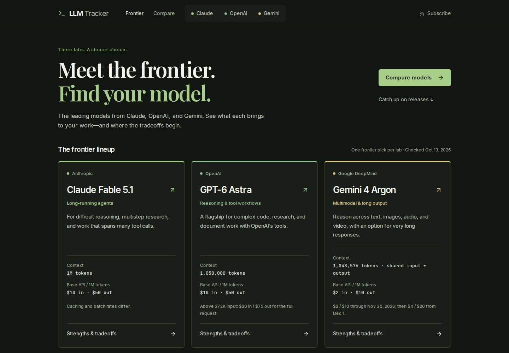
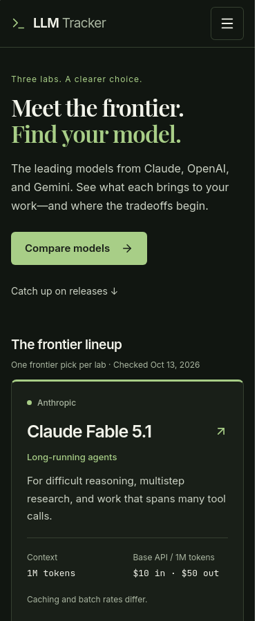
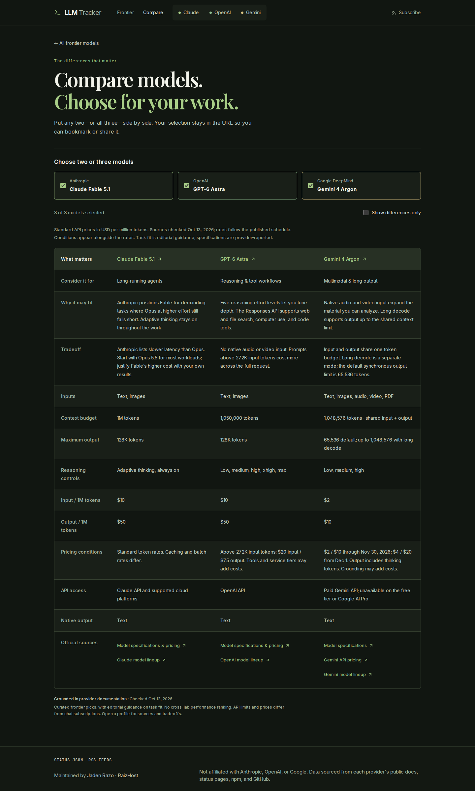
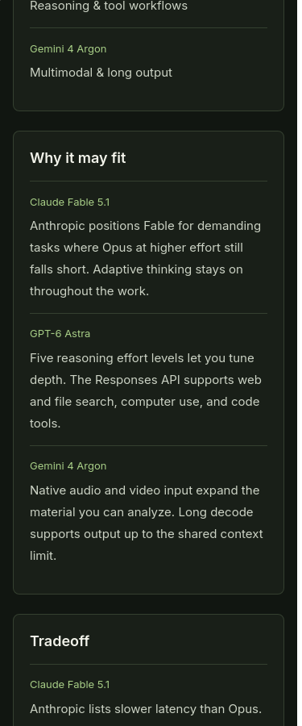

# Frontier model UI verification

The homepage, model profiles and direct comparisons were checked on October 14,
2026, against a production Next.js build with no database credentials and cron
disabled. The screenshots demonstrate the UI and its unavailable-data state;
they do not establish production ingestion health.

| Check | Result |
| --- | --- |
| Typecheck and lint | Passed; existing unrelated lint warnings remain |
| Navigation, catalog and comparison regressions | 15 passed, including five new comparison/routing/date regressions |
| Isolated database-read regressions | 12 passed |
| Production build and dynamic-route guard | Passed |
| Responsive layout | 70 unique route/width/engine combinations; no page overflow |
| axe WCAG 2/2.1/2.2 A/AA checks | 12 unique audits; zero violations |
| Comparison behavior | Pair/all selection, differences, URL reload, Back/Forward, zero/one-model states and keyboard controls passed |
| Navigation | Task guidance, profile pairs, mobile menu/Escape/focus restoration passed |
| Route and metadata behavior | Unknown/dotted/nested model URLs return 404; legacy `/models` redirect preserved; profile/compare canonical and Open Graph URLs checked |
| Database unavailable | Profiles stay visible; update feed reports unavailable |
| Independent review | Astra medium: technically ready for draft PR, visual accept; no remaining P1/P2 blockers |

Chromium and WebKit covered `/`, `/compare` and all three profile pages at 375,
412, 430, 768, 1024, 1280 and 1440px. Accessibility audits covered home, comparison
and the Argon profile at 375/1440px in each engine. Browser contexts used reduced
motion. Short-viewport and keyboard checks used emulation, not physical phones
or a screen reader. Field performance and actual-device behavior remain unmeasured.

The first browser harness asserted a destination before client navigation
completed; waiting for the URL corrected the harness. Rapid forced document
changes also produced WebKit prefetch errors. A settled user-navigation check
and a complete WebKit-only rerun waiting for in-flight requests both passed with
zero errors. Original failed-run logs are retained, not overwritten as successes.

Independent source review found missing card-level price conditions, rendering
dates presented as pricing verification dates, inherited homepage social metadata,
and dotted IDs bypassing middleware. The corrected build shows material price
conditions, actual source-check dates, page-specific metadata and strict profile
404 handling. No production settings or data were changed.

The final reviewer accepted the existing identity and the model-first hierarchy,
including mobile comparisons organized by attribute. It suggested compact mobile
profile links as optional future refinement. Two auxiliary opening captures were
found to show loading skeletons; the capture helper now waits for page content.
The committed comparison-depth and full-page captures already showed settled UI.

Evidence: `/tmp/llm-frontier-evidence/` contains build/prerender/test logs, both
browser attempts, settled WebKit results, source and final review records, native
captures and source hashes. The [task record](frontier-models.md) explains the
user-approved storage-lock exception. Profile maintenance is
[documented separately](../../content/frontier-models.md).

## Previews

